<!-- Header -->

  

  

  
  

---

### 👨‍💻 About Me

- 🔭 Working on **AI for software engineering**, especially automated classification of **Non-Functional Requirements (NFRs)**
- 🧠 Experimenting with **classic ML, deep learning and LLMs** (Llama 3.3 via Groq) on the PROMISE dataset
- 🌐 Building **full-stack web apps** with TypeScript and JavaScript
- 🌱 Always learning and open to collaboration

---

### 🛠️ Tech Stack

  
   
  

---

### 🚀 Featured Projects

<table>
  <tr>
    <td width="50%" valign="top">
      <h4><a href="https://github.com/Pluto2k2/Requify">🧾 Requify</a></h4>
      
Python desktop app that classifies software requirements into 7 categories using the Groq API and Llama 3.3.

      
      
    </td>
    <td width="50%" valign="top">
      <h4><a href="https://github.com/Pluto2k2/NFR-Decision-Tree">🌳 NFR Decision Tree</a></h4>
      
Interactive framework that recommends the best AI classification architecture for your NFRs and project constraints.

      
      
    </td>
  </tr>
  <tr>
    <td width="50%" valign="top">
      <h4><a href="https://github.com/Pluto2k2/NFR_Automated_Approaches_Classification_Comparission">📊 NFR Classification Comparison</a></h4>
      
Benchmarking machine learning approaches for software requirements classification on the PROMISE dataset.

      
      
    </td>
    <td width="50%" valign="top">
      <h4><a href="https://github.com/Pluto2k2/LAB2MARKET">🧪 LAB2MARKET</a></h4>
      
TypeScript web platform project.

      
    </td>
  </tr>
</table>

---

### 📈 GitHub Stats

  
  

  

  

---

<!-- Footer -->

  

